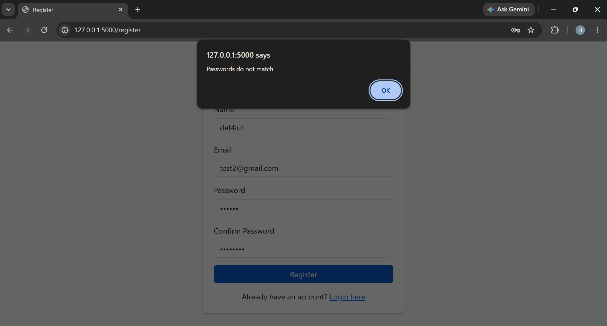
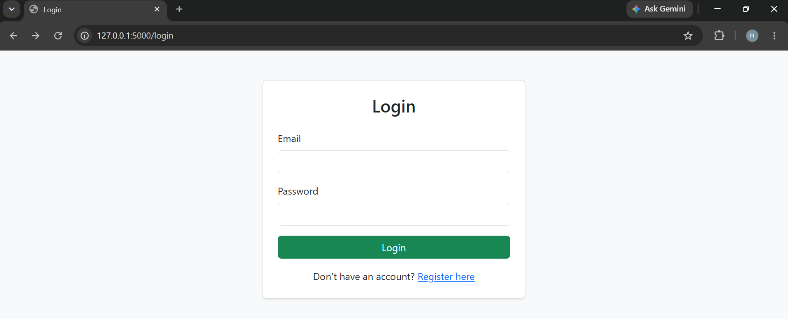
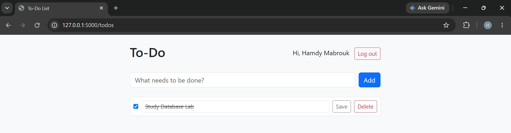
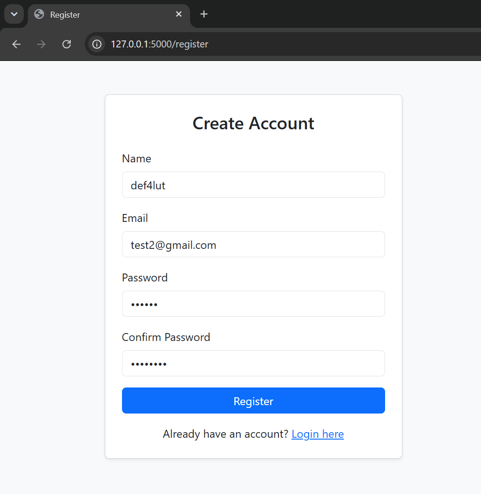

# Database Lab 2 - Flask To-Do Application

---

## 1. Team Members & Contributions

- **Member 1:** Hamdy Mabrouk
  - **ID:** 2304121
  - **Contributions:** Implemented the Flask backend logic (`app.py`), designed the MySQL database schema (`database/schema.sql`), integrated Bcrypt password hashing, and configured `.env` environment variables.

- **Member 2:** Ahmed Khyal 
  - **ID:** 2304125
  - **Contributions:** Developed frontend HTML templates with Bootstrap (`register.html`, `login.html`, `todos.html`), set up project documentation, captured application screenshots, and verified responsive UI design.

---

## 2. Technologies Used

- **Back End Framework:** Python 3 (Flask)
- **Front End Framework & Styling:** HTML5, CSS3, Bootstrap 5
- **Database Management System:** MySQL Server (using `PyMySQL` connector)
- **Security & Configuration:** `bcrypt` (for password hashing), `python-dotenv` (for environment variables management)

---

## 3. How to Run from an Empty Machine (Step-by-Step)

Follow these instructions to set up and run the application on a fresh machine:

### Prerequisites
- Python 3.x installed.
- MySQL Server installed and running locally.
- DBeaver or MySQL Workbench (optional, for DB inspection).

### Steps:

1. **Clone the Repository:**
   ```bash
   git clone <YOUR_GITHUB_REPOSITORY_URL>
   cd db-lab2-project
   
2.install Python Dependencies:

  bash
    pip install -r requirements.txt

3.Run the Database Initialization Script:

- Open MySQL / DBeaver.

- Execute the SQL script found at database/schema.sql.

- Note: The script starts with DROP DATABASE IF EXISTS registration; so it can be re-run cleanly at any time.

4.Configure Environment Variables:

- Copy .env.example to a new file named .env:

   Bash
      cp .env.example .env
- Edit .env and set your MySQL credentials:

   Plaintext
   DB_HOST=localhost
   DB_USER=root
   DB_PASSWORD=My_mysql_password
   DB_NAME=registration
   SECRET_KEY=My_secret_key

5.Start the Flask Development Server:
  Bash
    python app.py

6.Open the Application:
- Open your browser and navigate to: http://127.0.0.1:5000

---

## 4. Implemented Features (R1 – R10)
- R1 - Database Setup: Created registration DB with users and todos tables linked via Foreign Key (user_id).

- R2 - User Registration: Form validation for missing inputs, duplicate email checks, and password confirmation.

- R3 - Password Hashing: Passwords are securely hashed using bcrypt before database insertion.

- R4 - User Authentication: Secure login using hashed password verification, session management, and logout functionality.

- R5 - Display To-Do List: Authenticated users see only their personal to-do list items.

- R6 - Add To-Do: Logged-in users can add new items to their list.

- R7 - Update To-Do: Users can edit task titles and toggle completion status (is_done flag).

- R8 - Delete To-Do: Users can permanently delete tasks with confirmation dialogs.

- R9 - Security & Authorization: All SELECT, UPDATE, and DELETE queries strictly enforce AND user_id = %s isolation.

- R10 - Responsive UI: Interface styled with Bootstrap to ensure full functionality on desktop and mobile screens.

---

## 5. Screenshots

1. **Register Page with Error Messages:**
   

2. **Login Page:**
   

3. **To-Do List (with at least one task completed):**
   

4. **Site in a Phone-Sized Window (Mobile View):**
   

---

## 6. Conceptual Questions & Answers

### (a) Why do `UPDATE` and `DELETE` contain `AND user_id = ?`, and what changes if you remove it?
- **Why it is included:** It enforces **Data Ownership and Authorization**. It ensures that a logged-in user can only modify or delete tasks that belong specifically to their `user_id`.
- **What changes if removed:** Removing `AND user_id = ?` creates a severe security vulnerability (IDOR - Insecure Direct Object Reference). Any logged-in user could alter the `todo_id` in HTTP requests to update or delete tasks belonging to other users.

### (b) What happens if you insert a to-do for a `user_id` that does not exist, and which constraint of the lecture is that?
- **What happens:** MySQL will reject the query and throw an error: `Cannot add or update a child row: a foreign key constraint fails`.
- **Constraint:** This is the **Referential Integrity Constraint** (Foreign Key Constraint).

### (c) Why do you store a hash and not the password?
- **Answer:** For **Security and Confidentiality**. Storing plain-text passwords exposes user credentials if the database is leaked or accessed without authorization. Cryptographic hashes (like Bcrypt with salt) are one-way functions, making it computationally infeasible for attackers to reverse the hash back to the original password.

### (d) The `name` column is `NOT NULL`: why did you still need your own check for an empty name?
- **Answer:** In SQL, an empty string (`""`) sent from an HTML form input is treated as a **valid non-NULL value**. The database `NOT NULL` constraint only rejects literal `NULL` values. Therefore, application-level validation in Python/Flask is required to trim whitespace and verify that the user provided a real, non-empty string.